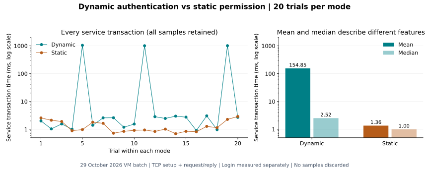

# Performance evaluation and static comparison

The question is: **what time is observed for authenticated dynamic access compared with an existing static allow rule?** This measures the cost/behavior of the two access modes in one VM environment; it does not claim that authentication makes a service faster.

## Metrics and conditions

| Mode / metric | Measurement |
|---|---|
| Dynamic `login_ms` | TCP login request through successful response, including credential decision and controller/switch confirmation |
| Dynamic `service_rtt_ms` | TCP connection, `GET_SECRET` request and complete protected-service reply |
| Dynamic `login_to_access_ms` | Start before login to completion of the service reply; excludes logout |
| Static `service_rtt_ms` | Same service transaction while a static source-specific rule is installed; no login |

The runner performs 20 sequential dynamic trials followed by 20 sequential static trials on the same single-switch topology. For these retained results the benchmark process runs in Ubuntu's root namespace through `10.0.0.254`; the baseline rule matches that source IP. It does **not** use h1's source address for the baseline. Each dynamic trial logs out and requires confirmed cleanup before appending its CSV row.

The static allow uses priority 200, the same destination/port and `NORMAL` action, a dedicated benchmark cookie, and a finite 60-second timeout. It is static because its permission is preinstalled without a login decision. The runner removes only that cookie's rule afterward. The baseline and dynamic mode both retain the priority-100 deny policy for other sources.

## Recorded results



| Metric | Samples | Mean (ms) | Median (ms) |
|---|---:|---:|---:|
| Dynamic login/control | 20 | 6.6608 | 5.9155 |
| Dynamic service transaction | 20 | 154.8531 | 2.5200 |
| Dynamic login-to-access | 20 | 161.5195 | 9.0790 |
| Static service transaction | 20 | 1.3555 | 0.9955 |

All samples remain in the [raw CSV](data/performance_results_current.csv). Three dynamic service trials exceed 1 second. Their cause was not isolated; do not attribute them to SDN alone or remove them to improve the average. The chart uses a logarithmic time axis to display small observations and large outliers together. Mean and median are labelled separately. The [full summary](data/PERFORMANCE.md) includes extrema, CSV hash and each observation over 100 ms.

## Recompute the summary without running the network

In the checkout root (Ubuntu or another Python environment):

```bash
python3 -B summarize_performance.py data/performance_results_current.csv --label 'Validated 29 October final-source VM batch'
python3 -B verification/check_project.py
```

The summary validates both modes, all expected trial IDs, nonnegative finite measurements and blank nonapplicable fields. This only reads existing measurements. Local mocked benchmark tests are not new Mininet performance data.

## Repeat the real experiment in Ubuntu

Use the [extended verification toolkit](verification/README.md) in a new directory. Link the existing controller environment, ensure earlier demos are stopped, and run:

```bash
sudo env PYTHONDONTWRITEBYTECODE=1 /usr/bin/python3 -B audit_live.py --output-dir /tmp/sdn-benchmark-UNIQUE
```

Replace `UNIQUE` with an unused name. The normal runner exercises the complete network and writes `fresh-performance.csv` into that new evidence directory. Inspect `results.json`, command exits and flow captures. The `--master` run adds extended challenges; use another fresh output directory. Do not run both together.

The runner generates a private control key temporarily, creates its own topology and servers, installs/removes the baseline rule, and cleans its own resources. Do not overwrite `data/performance_results_current.csv` with a new batch. Retain the tested source manifest and all raw observations alongside the new summary.

The measured difference is descriptive. A single ordered VM batch does not control scheduling, retransmissions or cache/order effects, and it provides no throughput/scalability claim. More independent batches with alternating mode order and controlled load would strengthen a research study; they are not represented by these retained measurements.
